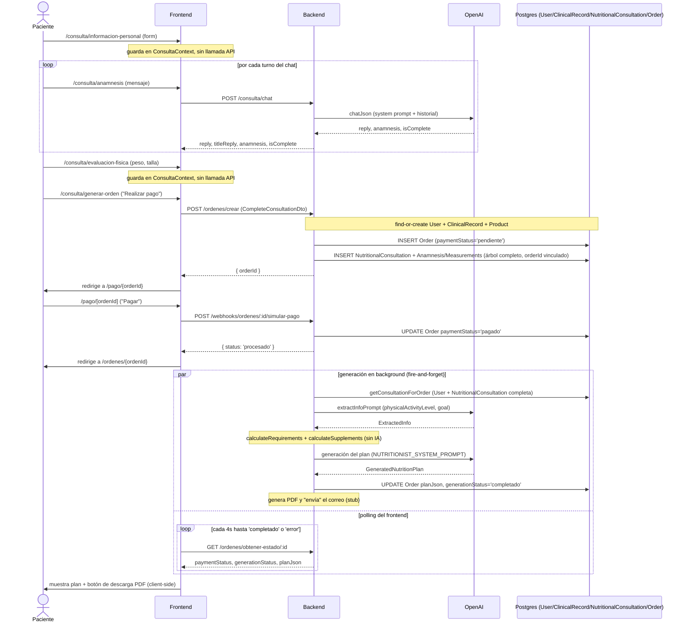

# Flujo happy path — Consulta nutricional

Este documento describe, paso a paso, el recorrido completo de una consulta que **sí llega a buen
puerto**: el paciente completa sus datos, conversa con la IA, paga y recibe su plan nutricional. Por
cada paso se indica la pantalla del frontend (`nutricionista-virtual-front`) involucrada y el/los endpoint(s)
del backend (`nutricionista-virtual-back`) que se consumen, en el orden real en que ocurren.

No cubre casos de error, reintentos de pago fallido, ni edge cases — para eso ver el código de cada
servicio (comentarios inline) y `doc/technical-debt.md`.

## Actores

- **Frontend**: Next.js (`nutricionista-virtual-front`), guarda el estado del flujo (`informacionPersonal`,
  `anamnesis`, `mediciones`) en `ConsultaContext`, persistido en `localStorage`
  (`src/shared/context/consulta.context.tsx`) para sobrevivir refrescos de página.
- **Backend**: NestJS (`nutricionista-virtual-back`), expone los endpoints REST.
- **OpenAI**: usado en 3 puntos del flujo (chat de anamnesis, extracción de nivel de actividad/objetivo,
  generación del plan).
- **Base de datos**: PostgreSQL vía Prisma (`prisma/schema.prisma`). El flujo persiste sobre el
  dominio real: `User` (identidad del paciente, resuelto por email), `ClinicalRecord` (uno por
  paciente), `NutritionalConsultation` (una por cada orden, con el árbol completo de `Anamnesis` y
  `Measurements`) y `Order` (estado de pago/generación y el plan resultante en `planJson`) — ver
  [orders-postgres-migration.md](./orders-postgres-migration.md) para el detalle de esta persistencia.
- **Pasarela de pago**: hoy **simulada** — no hay integración real con Mercado Pago/Flow/Stripe. El
  botón "Pagar" dispara el mismo endpoint que dispararía el webhook real de una pasarela.

## Diagrama de secuencia

## Paso a paso

### 1. `/consulta/iniciar-consulta` — pantalla informativa

Sin llamadas al backend. Solo explica los pasos de la consulta y enlaza a
`/consulta/informacion-personal`.

### 2. `/consulta/informacion-personal` — datos personales

`FormUserInfo` recoge nombre, apellidos, género, correo, fecha de nacimiento (RUT no está en uso
activo). Al enviar, se guarda en `ConsultaContext.setInformacionPersonal` (persistido en
`localStorage`) y se navega a `/consulta/anamnesis`. **No hay llamada al backend en este paso.**

### 3. `/consulta/anamnesis` — chat con la IA ("Nuvi")

`ChatAnamnesis` intercambia mensajes con el backend, un turno a la vez:

- **`POST /consulta/chat`** (`ConsultationController.chat` → `ConsultationService.chat`)
  - Request: `{ messages: {role, content}[], anamnesis?: AnamnesisDto }` (el estado acumulado de
    turnos anteriores).
  - El backend arma un system prompt con el esquema completo de la anamnesis, el orden estricto de
    recopilación (objetivos → clínica → alimentaria [r24h → preferencias → estrategia deportiva] →
    estilo de vida) y las reglas de completitud, y llama a OpenAI (`OpenaiService.chatJson`).
  - Normaliza la forma del `anamnesis` devuelto por el LLM (`normalizeAnamnesisPayload`) y recalcula
    `isComplete` en el servidor (`meetsCompletionRules`) en vez de confiar en el LLM.
  - Response: `{ reply, titleReply, anamnesis, isComplete }`.
- Este endpoint se llama **una vez por cada turno del paciente** (típicamente entre 8 y 15 turnos,
  según cuánto detalle dé el paciente) hasta que `isComplete === true`.
- Cuando `isComplete` es `true`, el frontend guarda el `anamnesis` final en `ConsultaContext` y navega
  a `/consulta/evaluacion-fisica`.

### 4. `/consulta/evaluacion-fisica` — datos antropométricos

`FormMediciones` recoge peso y talla (el resto de mediciones antropométricas del DTO —pliegues,
perímetros, diámetros— existen en el modelo pero no se piden en este formulario todavía). Se guarda
en `ConsultaContext.setMediciones` y se navega a `/consulta/generar-orden`. **Sin llamada al
backend.**

### 5. `/consulta/generar-orden` — resumen y creación de la orden

Pantalla de resumen/checkout. Al presionar "Realizar pago" (`BtnGenerarOrden`):

- **`POST /ordenes/crear`** (`OrdersController.create` → `OrdersService.createOrder`)
  - Request: `CompleteConsultationDto` completo — `{ personalInfo, anamnesis, measurements }`,
    armado con las tres piezas de estado acumuladas en `ConsultaContext`.
  - El backend resuelve/crea el `User` por email, su `ClinicalRecord` y el `Product` activo, crea la
    `Order` (`paymentStatus='pendiente'`, `generationStatus='no_iniciado'`) y crea en la misma
    operación el árbol completo `NutritionalConsultation` + `Anamnesis`/`Measurements` (y sus hijas),
    vinculado a la orden recién creada — ver
    [orders-postgres-migration.md § 5](./orders-postgres-migration.md#5-reescritura-de-srcpresentationordersordersservicets).
    Ya no se persiste un `payload_json` crudo. **La IA todavía no se ejecuta en este paso** — se crea
    la orden antes de cobrar para no perder los datos del paciente si el pago falla o el usuario
    cierra la pestaña.
  - Response: `{ orderId }`.
- El frontend redirige a `/pago/{orderId}`.

### 6. `/pago/[ordenId]` — pasarela de pago (simulada)

Checkout **simulado**: los campos de tarjeta son decorativos y no validan nada. Al presionar "Pagar":

- **`POST /webhooks/ordenes/:id/simular-pago`** (`WebhooksController.simulatePayment` →
  `WebhooksService.processPayment`)
  - Pensado como sustituto temporal del webhook real de una pasarela de pago (`POST /webhooks/pago`,
    que ya existe con la misma lógica y validación de firma — hoy un stub que siempre pasa — pero no
    tiene ninguna pasarela real que lo dispare aún).
  - Marca la orden `paymentStatus: 'pendiente' → 'pagado'` (operación idempotente: si ya estaba
    pagada, no hace nada y responde `{ status: 'ya_procesado' }`).
  - Dispara **en background** (fire-and-forget, sin esperar el resultado) la generación del plan:
    `PlanGenerationService.generatePlan(orderId)`. El endpoint responde de inmediato con
    `{ status: 'procesado' }`, sin esperar a que el plan esté listo.
- El frontend redirige a `/ordenes/{ordenId}`.

### 7. Generación del plan (proceso en segundo plano, sin request HTTP del frontend)

Disparado por el paso anterior, corre del lado del backend sin que el frontend lo invoque
directamente (`PlanGenerationService.generatePlan`):

1. **Guard de estado**: solo continúa si `generationStatus` es `no_iniciado` o `error` (evita que dos
   disparos concurrentes — p. ej. un reintento manual del webhook — generen el plan dos veces).
2. **Carga de datos**: obtiene la `Order` con su `User` (`findByIdWithUser`) y la
   `NutritionalConsultation` completa asociada a la orden (`getConsultationForOrder`) — la fuente de
   verdad de la anamnesis/mediciones ya no es un `payload_json` crudo, sino este árbol de entidades
   (ver [orders-postgres-migration.md](./orders-postgres-migration.md)), que se reconstruye en el
   mismo shape `CompleteConsultationDto` que usaba el flujo legacy para no tener que tocar el resto
   del pipeline.
3. **Llamada a OpenAI** (`EXTRACT_INFO_SYSTEM_PROMPT`) para clasificar, a partir de la anamnesis, el
   `physicalActivityLevel` (sedentario/moderado/activo) y el `goal` (definición/mantención/volumen).
4. **Cálculo local (sin IA)** de edad, requerimientos energéticos (TMB, GET, macros —
   `calculateRequirements`) y prescripción de suplementos (`calculateSupplements`), a partir de peso,
   talla, sexo, edad, nivel de actividad y objetivo.
5. **Llamada a OpenAI** (`NUTRITIONIST_SYSTEM_PROMPT`) para generar el plan completo: régimen,
   distribución de tiempos de comida (en porciones por grupo de intercambio de alimentos), suplementos
   y recomendaciones deportivas — usando **exactamente** los requerimientos ya calculados en el paso 4
   (no se le permite a la IA recalcularlos).
6. **Reintentos**: hasta 4 intentos con backoff exponencial (1s, 2s, 4s, 8s) si cualquiera de las
   llamadas anteriores falla, o si la IA reporta ejemplos/equivalencias que no calzan con las
   porciones ya calculadas por código.
   - Si tiene éxito: guarda `planJson` en la orden y marca `generationStatus: 'completado'`, luego
     llama a `EmailService.sendPlanByEmail` — genera el PDF del plan server-side (`PdfService`,
     `@react-pdf/renderer`) y "envía" el correo (hoy es un stub que solo logea; no hay proveedor de
     email real conectado todavía).
   - Si fallan los 4 intentos: marca `generationStatus: 'error'` y registra el evento (log
     estructurado; sin alerta real todavía, ver `doc/technical-debt.md`).

### 8. `/ordenes/[id]` — espera y resultado

Mientras el paso 7 corre en segundo plano, esta pantalla hace **polling cada 4 segundos** a:

- **`GET /ordenes/obtener-estado/:id`** (`OrdersController.getStatus` → `OrdersService.getStatus`)
  - Response: `{ paymentStatus, generationStatus, planJson }` (sin la `NutritionalConsultation` ni
    datos del `User`, que son información interna del pipeline).
- Mientras `generationStatus` sea `'no_iniciado'` o `'generando'`, se muestra un spinner (y, pasados
  45s sin terminar, un aviso de demora que tranquiliza al paciente: el pago ya quedó registrado).
- Cuando `generationStatus === 'completado'`, se muestra el plan y un botón de descarga que genera el
  PDF **en el cliente** (mismo documento react-pdf que usa el backend para el adjunto del correo, pero
  ejecutado en el navegador — no hay llamada adicional al backend para esto).
- Si `generationStatus === 'error'`, se muestra un mensaje indicando que el pago quedó registrado y
  que el equipo ya fue notificado (vía el log del paso 7).

## Tabla resumen de endpoints (en orden de uso)

| # | Endpoint | Pantalla que lo dispara | Repeticiones | Efecto |
|---|---|---|---|---|
| 1 | `POST /consulta/chat` | `/consulta/anamnesis` | 1 vez por turno del chat | Llama a OpenAI, devuelve la siguiente pregunta y el estado acumulado de la anamnesis |
| 2 | `POST /ordenes/crear` | `/consulta/generar-orden` | 1 vez | Crea `User`/`ClinicalRecord`/`Product` (find-or-create), la `Order` (`paymentStatus='pendiente'`) y el árbol `NutritionalConsultation`, sin llamar a la IA todavía |
| 3 | `POST /webhooks/ordenes/:id/simular-pago` | `/pago/[ordenId]` | 1 vez | Marca la orden como pagada y dispara la generación del plan en background |
| — | *(sin request del frontend)* | — | — | `PlanGenerationService.generatePlan`: lee la `NutritionalConsultation` de la orden, 2 llamadas a OpenAI + cálculo local + guardado del plan + envío de correo (stub) |
| 4 | `GET /ordenes/obtener-estado/:id` | `/ordenes/[id]` | cada 4s hasta `completado`/`error` | Polling del estado de pago/generación y, al terminar, del plan generado |

Endpoint equivalente no usado en este flujo (queda para cuando se integre una pasarela real):
**`POST /webhooks/pago`** — mismo efecto que el endpoint #3, pero pensado para ser llamado por la
pasarela de pago real en vez de por el frontend.

## Notas relevantes

- **El flujo ya no es stateless**: a diferencia de una versión anterior de este proyecto (ver
  `README.md`), el estado de la orden (estado de pago, estado de generación, plan resultante) y todo
  el árbol de la consulta (`User`/`ClinicalRecord`/`NutritionalConsultation`/`Anamnesis`/`Measurements`)
  se persisten en PostgreSQL vía Prisma (`prisma/schema.prisma`), porque el webhook de pago es
  server-a-server y no tiene acceso al `localStorage` del navegador del paciente. Ver
  [orders-postgres-migration.md](./orders-postgres-migration.md) para el detalle de esta persistencia
  (reemplazó a un `payload_json`/`planJson` como strings crudos sobre un modelo `Order` que ya no
  existe).
- **La IA se ejecuta 3 veces en total por consulta**: una vez por turno en el chat de anamnesis (paso
  3), y dos veces más en la generación del plan (extracción de nivel de actividad/objetivo + generación
  del plan en sí, paso 7).
- **El pago es simulado**: no hay pasarela real integrada. El endpoint que sí quedaría para producción
  (`POST /webhooks/pago`, con verificación de firma) existe pero su verificación
  (`WebhooksService.verifyWebhookSignature`) siempre devuelve `true` hoy.
- **El envío de correo es un stub**: `EmailService.sendRealEmail` solo logea, no hay proveedor
  (SendGrid/SES/Resend/etc.) conectado. El PDF sí se genera de verdad (server-side para el adjunto,
  client-side para la descarga manual).
- **Retención de datos**: un cron diario (`RetentionService`, 03:00) anonimiza (`Order.planJson` →
  `null`) las órdenes con más de 45 días, conservando la fila para auditoría/estadística. Los datos
  clínicos de la `NutritionalConsultation` asociada no se anonimizan todavía (ver
  `doc/technical-debt.md`).
